

  

  

Cybersecurity · Game development · EUW

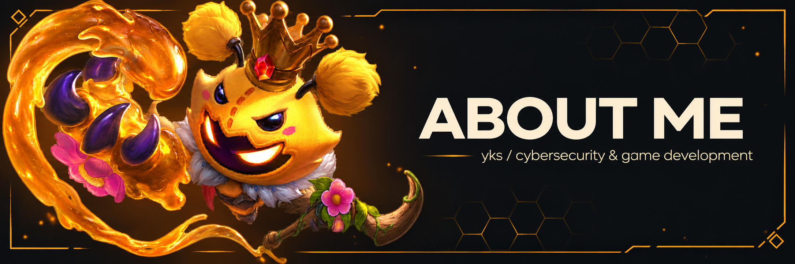

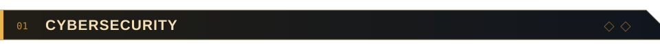

I'm studying cybersecurity at ESILV (BIC), with an interest in offensive security and red teaming.

I've been exploring security through hands-on challenges for around 6–7 years. I practice on Root-Me, Hack The Box and TryHackMe in my free time.

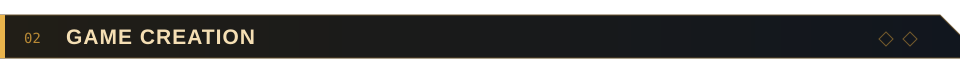

Outside my studies, I enjoy building games in Roblox Studio—even when they never get released. I'm learning about core loops, onboarding, retention, monetization and marketing.

I'd like to build a career in cybersecurity or game development. When I'm not working on a project, I'm usually playing Cyberpunk or League of Legends.

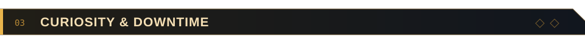

I'm also curious about AI, data science, cryptocurrency and crypto security. I spend a lot of time reading online.

I read a lot about maths and philosophy. My maths skills are still developing, but I often find myself reading about topics well beyond what I can solve.

**EUW · Trundle / Jax / Veigar**

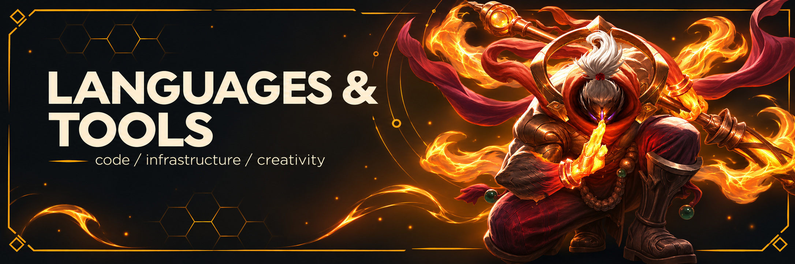

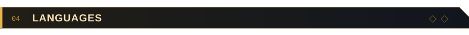

Luau · Python · TypeScript · JavaScript · C++ · HTML/CSS · SQL

Languages I've used through coursework, personal projects and experiments. Still learning.

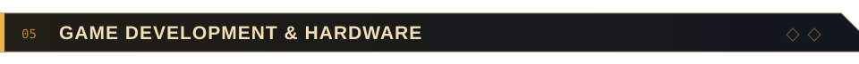

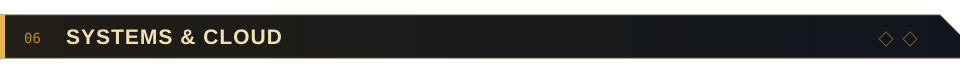

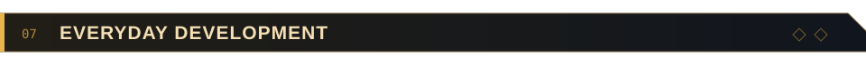

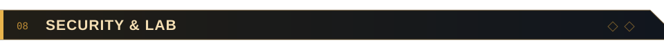

**Tools:** Burp Suite · Nmap

**Practice:** Root-Me · Hack The Box · TryHackMe · DVWA

**Home lab:** BlackArch Linux · BadUSB devices · RTL-SDR v2 · RFID reader/writer

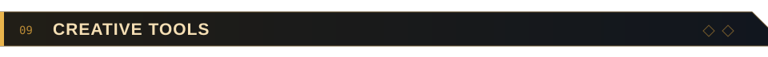

Video editing and motion graphics, with an interest in 3D and music production.

  

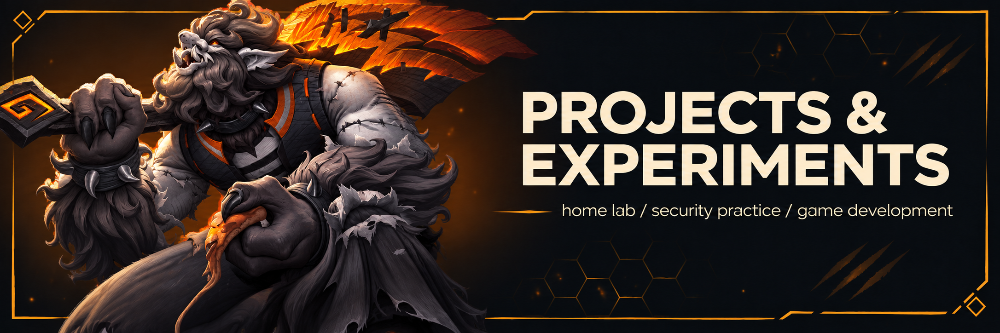

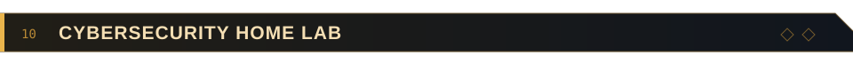

A low-end desktop repurposed into a dedicated BlackArch Linux lab for hands-on cybersecurity learning. My hardware experiments include BadUSB devices, RTL-SDR v2 radio reception, and RFID reading/writing.

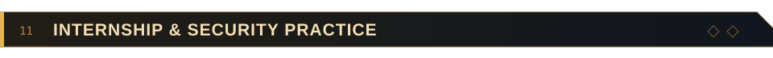

During my internship at ChapsVision, I explored Microsoft Azure, mainly as a learning experience, and spent time practicing security challenges. I completed DVWA's low and medium security levels with help from web research.

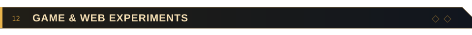

- **Roblox prototypes** — exploring gameplay systems, progression and the first few minutes of a player's experience.
- **Coursework & web projects** — experimenting with applications, databases and connected devices.
- **Currently learning** — offensive security and what makes a game worth coming back to.

[Explore my repositories](https://github.com/8yanks?tab=repositories)

## Activity

  

  

## Contact

  
  
  
  
  

  

