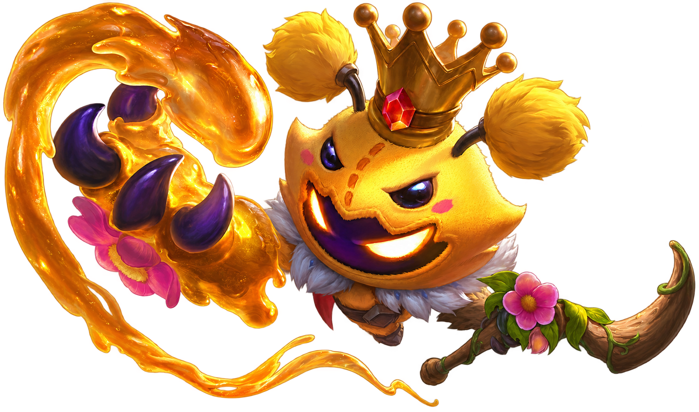
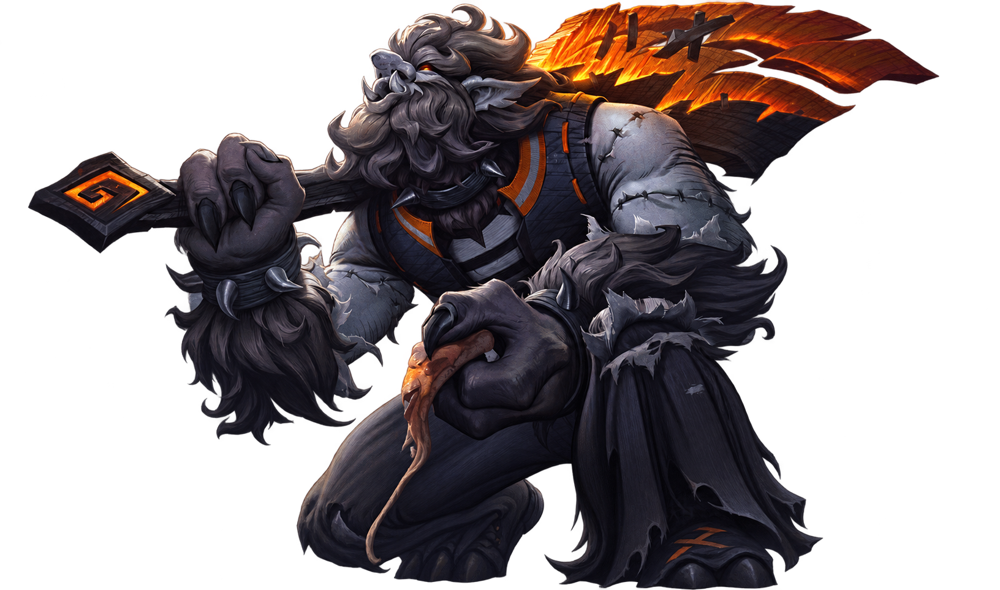
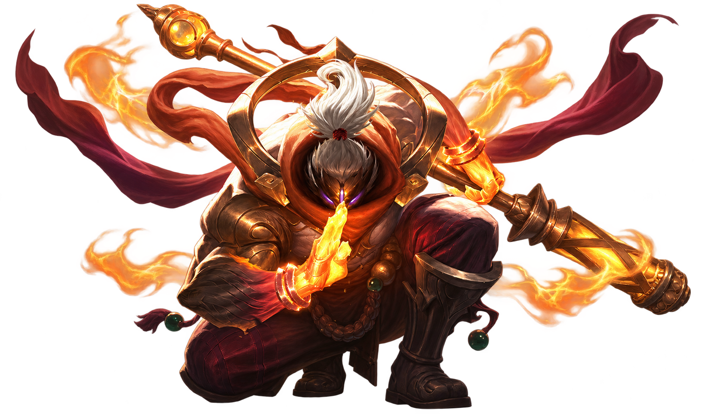

<h1 align="center">yks</h1>

<strong>Cybersecurity student · Game developer · EUW</strong> 
I take things apart to understand them, then I build my own.

<table>
<tr>
<td width="40%" align="center" valign="middle"></td>
<td width="60%" valign="top"><h2>About me</h2>

<strong>Security is where I started.</strong> I study cybersecurity and I'm aiming for offensive security and red teaming. I've been doing hands-on challenges for six or seven years on Root-Me, Hack The Box and TryHackMe, and I keep a home lab so I can break things safely.

<strong>Building is how I learn.</strong> Most evenings I'm in Roblox Studio working on combat systems, VFX, progression and the first five minutes of a player's experience. Most of my prototypes never ship. Each one still teaches me something about core loops, onboarding and why players come back.

<strong>Right now</strong>

<ul>
<li><strong>Learning:</strong> offensive security, one lab at a time.</li>
<li><strong>Building:</strong> Roblox prototypes, Blender assets and small tools I need myself.</li>
<li><strong>Studying:</strong> order flow and market structure, on paper before any real money.</li>
<li><strong>Reading:</strong> maths and philosophy, often well beyond what I can solve yet.</li>
</ul>

<strong>How I work:</strong> AI-assisted workflows, Obsidian vaults for research and project context, and curated asset libraries I reuse across projects. When I'm not building, I'm playing Cyberpunk or League of Legends.

</td>
</tr>
</table>

<table>
<tr>
<td width="40%" align="center" valign="middle"></td>
<td width="60%" valign="top"><h2>Selected work</h2>

<a href="https://github.com/8yanks/riftline"><strong>riftline</strong></a>: a personal League of Legends assistant with match stats, a local overlay and draft-based rune and item suggestions. It never reads game memory or touches the client.

<a href="https://github.com/8yanks/tmp-etherea"><strong>etherea</strong></a>: 25 real-time GLSL effects for video and photo. Everything runs on your GPU in the browser and nothing is uploaded.

<a href="https://github.com/8yanks/capri-desktop"><strong>capri-desktop</strong></a>: a Windows desktop companion with hand-animated sprites, a Markdown memory vault and Codex or Claude conversations.

<a href="https://github.com/8yanks/smartParking"><strong>smartParking</strong></a>: a team IoT project. Three ESP32 boards with ultrasonic sensors and OLED panels report to a Next.js and Prisma dashboard.

<a href="https://github.com/8yanks/nexus"><strong>nexus</strong></a>: a multi-asset monitoring dashboard for market research. It runs in analyst mode only, with no live trading.

<a href="https://github.com/8yanks/scripts"><strong>scripts</strong></a>: Luau utilities for Roblox Studio.

  

</td>
</tr>
</table>

<table>
<tr>
<td width="60%" valign="middle"><h2>Lab &amp; practice</h2>

<strong>At home:</strong> an old desktop turned into a dedicated BlackArch Linux lab, plus BadUSB devices, an RTL-SDR v2 for radio reception and RFID reading and writing tools.

<strong>Practice:</strong> Burp Suite and Nmap, with challenges on Root-Me, Hack The Box, TryHackMe and DVWA.

<strong>Internship:</strong> security monitoring, external risk assessment and cloud fundamentals in a SOC.

</td>
<td width="40%" align="center" valign="middle"></td>
</tr>
</table>

## Toolkit

<table>
<tr><td width="30%"><h3>Languages</h3>Scripts, applications &amp; data</td><td> </td></tr>
<tr><td><h3>Build &amp; prototype</h3>Games &amp; hardware</td><td></td></tr>
<tr><td><h3>Run &amp; deploy</h3>Systems &amp; cloud</td><td></td></tr>
<tr><td><h3>Everyday tools</h3>Code &amp; collaboration</td><td></td></tr>
<tr><td><h3>Create &amp; edit</h3>Video, motion, 3D &amp; music</td><td>  </td></tr>
</table>

## Activity

  

  

## Contact

  
  
  

  <a href="ARTWORK.md">Artwork credits</a>
  

