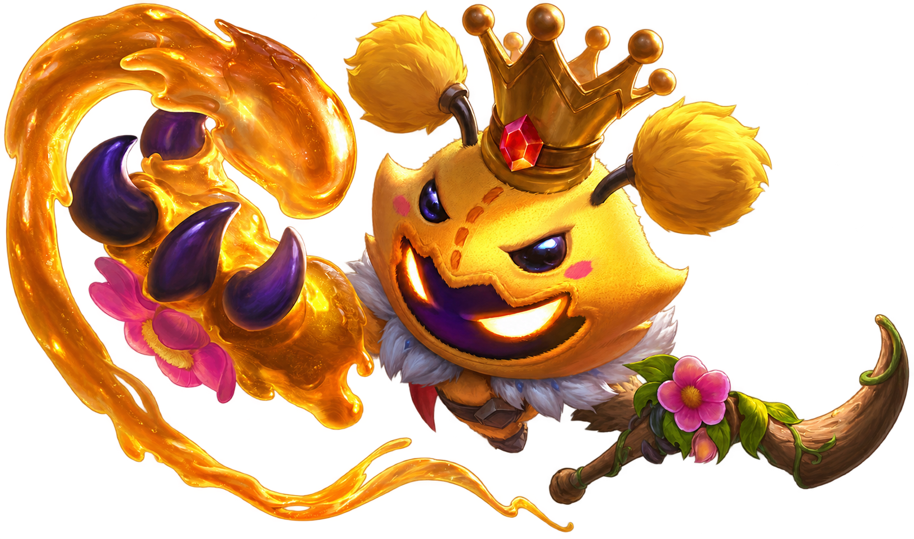
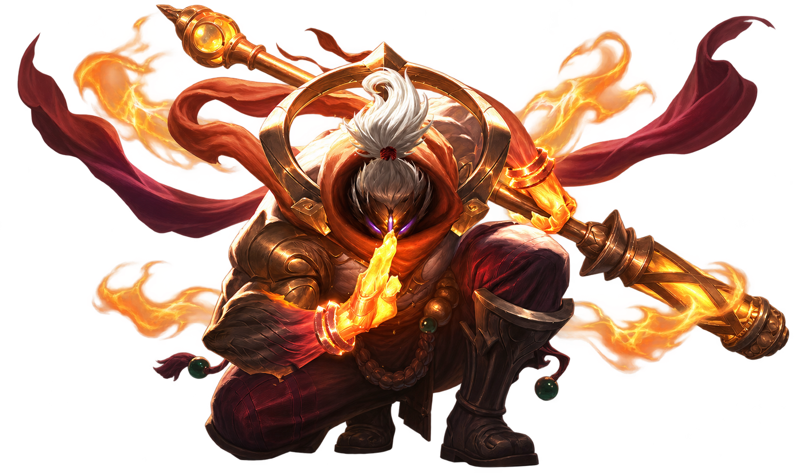
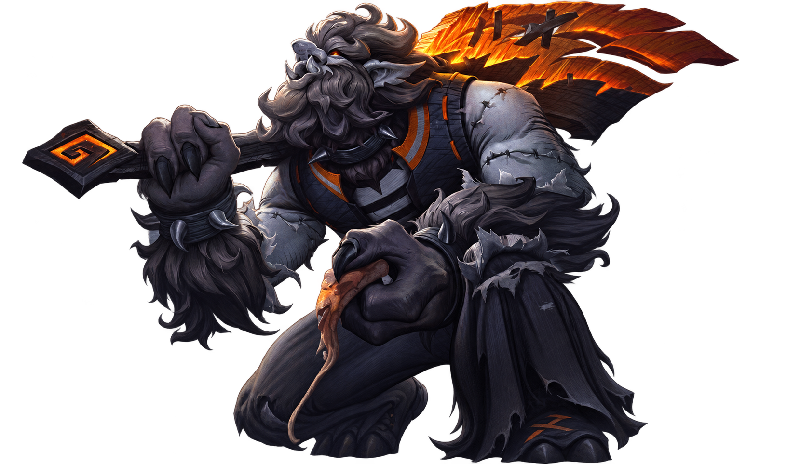
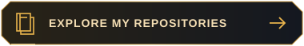

<h1 align="center">yks</h1>

<strong>Cybersecurity · Game development · EUW</strong>

<table>
<tr>
<td width="40%" align="center" valign="middle"></td>
<td width="60%" valign="top"><h2>About me</h2>

<strong>Security is where I started.</strong>

I'm studying cybersecurity, with an interest in offensive security and red teaming.

I've been exploring security through hands-on challenges for around 6–7 years. I practice on Root-Me, Hack The Box and TryHackMe in my free time.

<strong>Building is how I learn.</strong>

Outside my studies, I enjoy building games in Roblox Studio—even when they never get released. I'm learning about core loops, onboarding, retention, monetization and marketing.

I'd like to build a career in cybersecurity or game development. When I'm not working on a project, I'm usually playing Cyberpunk or League of Legends.

<strong>Away from the keyboard</strong>

I'm also curious about AI, data science, cryptocurrency and crypto security. I spend a lot of time reading online.

I read a lot about maths and philosophy. My maths skills are still developing, but I often find myself reading about topics well beyond what I can solve.

<strong>How I work:</strong> I use AI-assisted workflows alongside curated asset libraries and Obsidian vaults to organize research, reuse resources and keep project context.

</td>
</tr>
</table>

<table>
<tr>
<td width="60%" valign="middle"><h2>Languages &amp; tools</h2>

My toolkit — through coursework, experiments and personal projects. Still learning.

</td>
<td width="40%" align="center" valign="middle"></td>
</tr>
</table>

<table>
<tr><td width="30%"><h3>Languages</h3>Scripts, applications &amp; data</td><td> </td></tr>
<tr><td><h3>Build &amp; prototype</h3>Games &amp; hardware</td><td></td></tr>
<tr><td><h3>Run &amp; deploy</h3>Systems &amp; cloud</td><td></td></tr>
<tr><td><h3>Everyday tools</h3>Code &amp; collaboration</td><td></td></tr>
<tr><td><h3>Create &amp; edit</h3>Video, motion, 3D &amp; music</td><td>  </td></tr>
</table>

<blockquote>

<strong>On the security side:</strong> Burp Suite and Nmap for practice; Root-Me, Hack The Box, TryHackMe and DVWA for challenges. At home: a BlackArch desktop, BadUSB devices, RTL-SDR v2 and RFID tools.

</blockquote>

<strong>Internship experience:</strong> security monitoring, risk assessment and cloud fundamentals in a SOC environment.

<table>
<tr>
<td width="40%" align="center" valign="middle"></td>
<td width="60%" valign="top"><h2>Projects &amp; experiments</h2>
<h3>01 / At home</h3>

A low-end desktop repurposed into a dedicated BlackArch Linux lab for hands-on cybersecurity learning. My hardware experiments include BadUSB devices, RTL-SDR v2 radio reception, and RFID reading/writing.

<h3>02 / Internship experience</h3>

My SOC internship introduced me to security monitoring, external risk assessment and cloud environments. I also practiced web security through hands-on lab exercises.

<h3>03 / In development</h3>
<ul>
<li><strong>Roblox prototypes</strong> — exploring gameplay systems, progression and the first few minutes of a player's experience.</li>
<li><strong>Coursework &amp; web projects</strong> — experimenting with applications, databases and connected devices.</li>
<li><strong>Currently learning</strong> — offensive security and what makes a game worth coming back to.</li>
</ul>

  

</td>
</tr>
</table>

## Activity

  

  

## Contact

  
  
  

  

